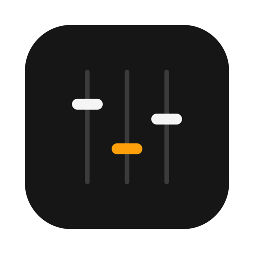
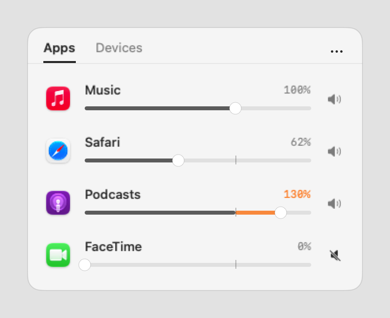
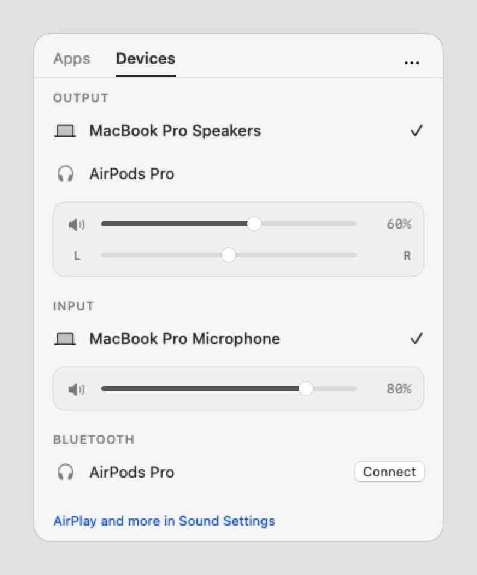

<div align="center">



# OpenSoundSource

**Per-app volume and device control, from your macOS menu bar.**<br>
**Volume per app e controllo dei dispositivi, dalla barra dei menu di macOS.**

[](LICENSE)
[](#requirements)
[](https://swift.org)
[](https://github.com/jimmyxan/OpenSoundSource/releases/latest)

[English](#english) · [Italiano](#italiano)

<br>

<picture>
  <source media="(prefers-color-scheme: dark)" srcset="docs/apps-dark.png">
  
</picture>
&nbsp;
<picture>
  <source media="(prefers-color-scheme: dark)" srcset="docs/devices-dark.png">
  
</picture>

<sub>Demo data. Screenshots follow your GitHub theme (light or dark) / Dati dimostrativi. Gli screenshot seguono il tema di GitHub (chiaro o scuro).</sub>

</div>

---

## English

OpenSoundSource sits in the menu bar and lets you turn individual apps up or down, pick audio devices and keep everything tidy, without a virtual audio driver. It is an independent project written from scratch with Apple's public APIs. It is not affiliated with Rogue Amoeba and contains no SoundSource code, assets or data.

### Highlights

| | |
|---|---|
| **Per-app volume** | 0 to 150% with mute and a magnetic snap at 100% |
| **Safe boost** | Soft-knee limiter, so boosted audio does not clip |
| **Helper processes** | Works with Microsoft Teams, browsers and Electron apps, which play sound from helper processes |
| **Only what plays** | The app list shows only apps making sound right now (switchable) |
| **Devices** | Default output and input, volume, mute and balance |
| **Bluetooth** | Connect and disconnect paired audio devices |
| **Follows your devices** | Per-app volumes carry over when the default device changes, for example when you put on AirPods |
| **Light** | Launch at login, near-zero idle cost: no polling while the popover is closed and no tap is active |

### Requirements

- macOS 14.2 or later (CoreAudio process taps)
- Apple Silicon or Intel Mac

### Install

#### Option A: download the release

1. Download `OpenSoundSource-0.1.2-macos-universal.zip` from the [latest release](https://github.com/jimmyxan/OpenSoundSource/releases/latest).
2. Unzip it and drag `OpenSoundSource.app` into `/Applications`.
3. The app is ad-hoc signed and not notarized, so macOS blocks the first launch. Remove the quarantine flag once:

   ```bash
   xattr -dr com.apple.quarantine /Applications/OpenSoundSource.app
   ```

   Alternatively, right-click the app, choose **Open**, then confirm.
4. Open the app and follow [First run](#first-run).

#### Option B: build from source

1. Install the Xcode command line tools (Swift 5.9 or later):

   ```bash
   xcode-select --install
   ```

2. Clone, build and launch:

   ```bash
   git clone https://github.com/jimmyxan/OpenSoundSource.git
   cd OpenSoundSource
   make run
   ```

   `make run` builds in release mode, creates `OpenSoundSource.app`, signs it locally and opens it.
3. Optional, to install it permanently:

   ```bash
   cp -R OpenSoundSource.app /Applications/
   ```

### First run

1. Click the three-sliders icon in the menu bar. If it is missing, your menu bar may be full: quit a few menu bar apps or use a menu bar manager.
2. Allow **System audio recording** when macOS asks (Privacy & Security). Without it the sliders do nothing, and the app shows a warning with a button that opens the right settings pane.
3. Allow **Bluetooth** only if you want to connect devices from the Devices tab.
4. Play something. The app shows up in the **Apps** tab: drag its slider.

### Usage

- **Apps tab**: drag an app's slider to change its volume. Click the percentage to reset to 100%. The button on the right toggles mute. Above 100% the slider turns orange (boost).
- **Devices tab**: click a device to make it the default. Volume, mute and balance of the selected device appear below it.
- **`...` menu**: launch at login, the "Only apps playing audio" filter, reset all volumes, quit.

"Launch at login" works best with the app in `/Applications`. If macOS asks for approval, the switch is in System Settings, General, Login Items.

### Development

```bash
swift build -c release                      # build only
make app                                    # build and create the .app bundle
.build/debug/OpenSoundSource --selftest     # limiter check (after swift build)
.build/release/OpenSoundSource --snapshot docs # render the README screenshots (demo data, light and dark)
```

| File | Role |
|---|---|
| `Sources/OpenSoundSource/main.swift` | Per-app taps, limiter, model, app delegate, `--snapshot` / `--selftest` |
| `Sources/OpenSoundSource/Devices.swift` | CoreAudio devices, Bluetooth, launch at login |
| `Sources/OpenSoundSource/Views.swift` | SwiftUI interface |
| `Resources/AppIcon.icns`, `docs/logo.svg` | App icon and logo |

### Known limitations

- The tap assumes stereo interleaved float32 audio. Multichannel devices or unusual formats may sound wrong.
- Audio with a changed volume plays on the system default device, not on a device chosen per app.
- AirPlay: an already connected device is controlled like any other, but discovering and connecting new receivers needs private APIs. Use macOS Sound settings for that.
- The limiter is an envelope-free waveshaper: with heavy boost it can add mild saturation.
- Volumes are not remembered between launches.
- Ad-hoc signed and not notarized (see [Install](#install)).
- No automated tests beyond the limiter check. Everything else was verified by hand.

### Legal note

The name SoundSource belongs to Rogue Amoeba Software. This project is an independent implementation of general ideas (per-app volume) using public APIs and does not intend to imitate their trademark, artwork or code.

### License

[MIT](LICENSE)

---

## Italiano

OpenSoundSource vive nella barra dei menu e ti permette di alzare o abbassare il volume di ogni app, scegliere i dispositivi audio e tenere tutto in ordine, senza un driver audio virtuale. È un progetto indipendente, scritto da zero con le API pubbliche di Apple. Non è affiliato a Rogue Amoeba e non contiene codice, asset o dati di SoundSource.

### In breve

| | |
|---|---|
| **Volume per app** | Da 0 a 150%, con mute e aggancio magnetico a 100% |
| **Boost sicuro** | Limitatore soft-knee: sopra 100% l'audio non va in clipping |
| **Processi helper** | Funziona con Microsoft Teams, browser e app Electron, che suonano da processi helper |
| **Solo ciò che suona** | L'elenco mostra solo le app che stanno emettendo suono (attivabile) |
| **Dispositivi** | Uscita e ingresso predefiniti, volume, mute e bilanciamento |
| **Bluetooth** | Connessione e disconnessione delle periferiche audio accoppiate |
| **Segue i dispositivi** | I volumi per app restano al cambio del dispositivo predefinito, per esempio quando metti le AirPods |
| **Leggera** | Avvio al login, consumo a riposo quasi nullo: nessun polling con il popover chiuso e nessun tap attivo |

### Requisiti

- macOS 14.2 o successivo (process tap di CoreAudio)
- Mac con Apple Silicon o Intel

### Installazione

#### Opzione A: scarica la release

1. Scarica `OpenSoundSource-0.1.2-macos-universal.zip` dall'[ultima release](https://github.com/jimmyxan/OpenSoundSource/releases/latest).
2. Decomprimilo e trascina `OpenSoundSource.app` in `/Applications`.
3. L'app ha una firma ad-hoc e non è notarizzata, quindi macOS blocca il primo avvio. Rimuovi il flag di quarantena una volta sola:

   ```bash
   xattr -dr com.apple.quarantine /Applications/OpenSoundSource.app
   ```

   In alternativa, clic destro sull'app, **Apri**, poi conferma.
4. Apri l'app e segui [Primo avvio](#primo-avvio).

#### Opzione B: compila dai sorgenti

1. Installa gli strumenti da riga di comando di Xcode (Swift 5.9 o successivo):

   ```bash
   xcode-select --install
   ```

2. Clona, compila e avvia:

   ```bash
   git clone https://github.com/jimmyxan/OpenSoundSource.git
   cd OpenSoundSource
   make run
   ```

   `make run` compila in modalità release, crea `OpenSoundSource.app`, la firma in locale e la apre.
3. Facoltativo, per installarla in modo stabile:

   ```bash
   cp -R OpenSoundSource.app /Applications/
   ```

### Primo avvio

1. Clicca l'icona con i tre cursori nella barra dei menu. Se non c'è, la barra potrebbe essere piena: chiudi qualche icona o usa un gestore della barra.
2. Consenti la **Registrazione audio di sistema** quando macOS lo chiede (Privacy e sicurezza). Senza questo permesso gli slider non hanno effetto e l'app mostra un avviso con il pulsante che apre il pannello giusto.
3. Consenti il **Bluetooth** solo se vuoi connettere dispositivi dalla scheda Devices.
4. Fai partire un audio. L'app compare nella scheda **Apps**: trascina il suo slider.

### Come si usa

- **Scheda Apps**: trascina lo slider di un'app per cambiarne il volume. Clicca la percentuale per tornare a 100%. Il pulsante a destra attiva il mute. Oltre 100% lo slider diventa arancione (boost).
- **Scheda Devices**: clicca un dispositivo per renderlo predefinito. Sotto compaiono volume, mute e bilanciamento del dispositivo selezionato.
- **Menu `...`**: avvio al login, filtro "Only apps playing audio", azzera tutti i volumi, esci.

L'avvio al login funziona meglio con l'app in `/Applications`. Se macOS chiede un'approvazione, l'interruttore è in Impostazioni di Sistema, Generali, Elementi login.

### Sviluppo

```bash
swift build -c release                      # solo compilazione
make app                                    # compila e crea il bundle .app
.build/debug/OpenSoundSource --selftest     # controllo del limitatore (dopo swift build)
.build/release/OpenSoundSource --snapshot docs # genera gli screenshot del README (dati dimostrativi, chiaro e scuro)
```

| File | Ruolo |
|---|---|
| `Sources/OpenSoundSource/main.swift` | Tap per app, limitatore, modello, delegate |
| `Sources/OpenSoundSource/Devices.swift` | Dispositivi CoreAudio, Bluetooth, avvio al login |
| `Sources/OpenSoundSource/Views.swift` | Interfaccia SwiftUI |
| `Resources/AppIcon.icns`, `docs/logo.svg` | Icona dell'app e logo |

### Limiti noti

- Il tap presuppone audio stereo float32 interleaved. Dispositivi multicanale o formati insoliti possono suonare male.
- L'audio con volume modificato esce sul dispositivo predefinito di sistema, non su un dispositivo scelto per singola app.
- AirPlay: un dispositivo già connesso si controlla come gli altri, ma scoprire e collegare nuovi ricevitori richiede API private. Usa le impostazioni Suono di macOS.
- Il limitatore è un waveshaper senza inviluppo: con boost forte può aggiungere una leggera saturazione.
- I volumi non vengono ricordati tra un avvio e l'altro.
- Firma ad-hoc e nessuna notarizzazione (vedi [Installazione](#installazione)).
- Nessun test automatico oltre al controllo del limitatore. Il resto è stato verificato solo a mano.

### Note legali

Il nome SoundSource appartiene a Rogue Amoeba Software. Questo progetto è un'implementazione indipendente di idee generali (volume per app) con API pubbliche e non intende imitarne marchio, grafica o codice.

### Licenza

[MIT](LICENSE)
